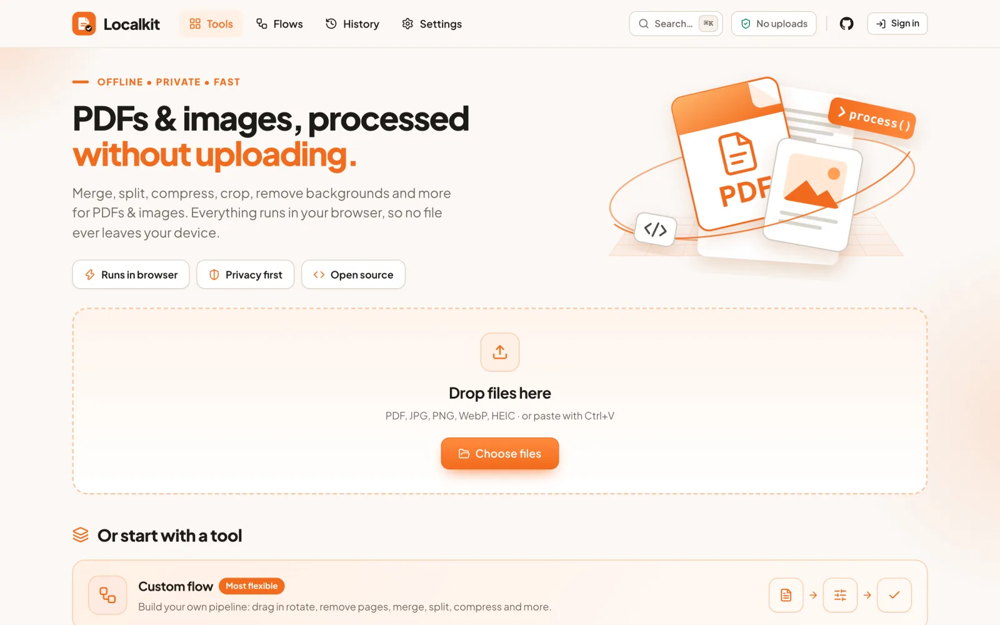
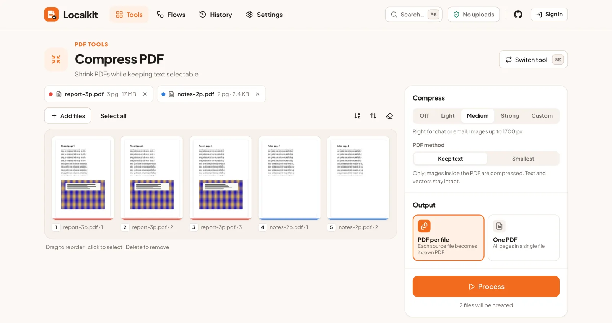
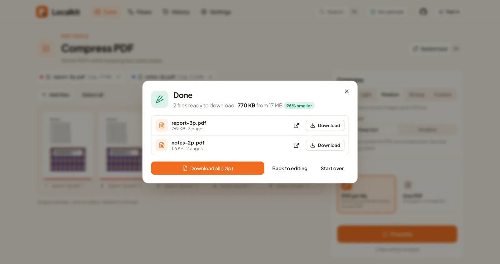
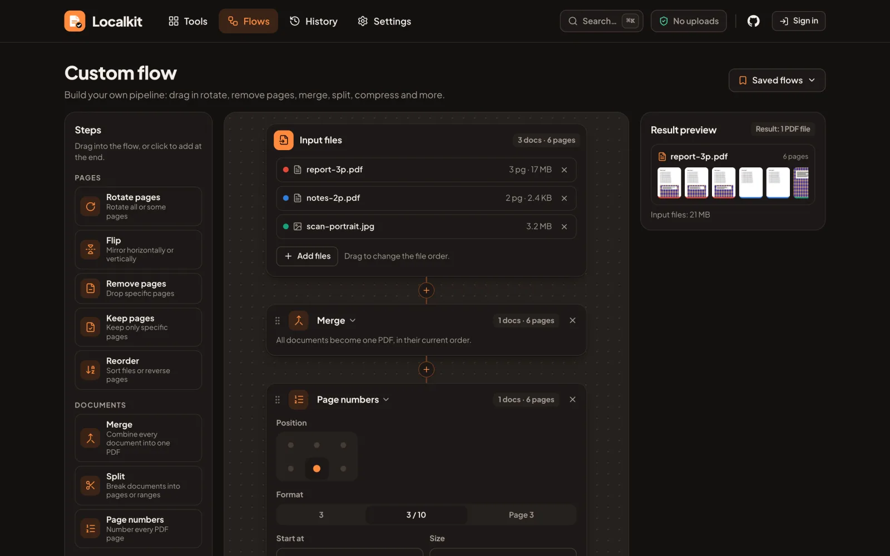

<div align="center">


# Localkit

**PDF and image tools that run entirely in your browser. Your files are never uploaded.**

[**localkit.ahmadarif.id**](https://localkit.ahmadarif.id)




</div>

## Overview

Most online PDF and image tools send your documents to someone else's server.
Localkit is a static web app that does the same jobs locally. Every file is read,
processed and saved by your own browser. A strict Content Security Policy keeps
the page from sending data to any other origin.

- **19 tools in one place:** 8 for PDFs, 10 for images, plus a custom workflow builder.
- **Private by construction:** no uploads, no analytics, no third-party scripts, no tracking cookies.
- **Works offline:** installable as a PWA. After the first visit, every tool works without a connection.
- **Built for real files:** PDF parsing and the AI model run off the main thread, in Web Workers and WebAssembly.
- **Bilingual:** English and Bahasa Indonesia. Light and dark themes.

## Tools

| PDF | Image |
| --- | --- |
| Images to PDF | Compress images |
| Merge PDF | Resize (pixels, percent, social and passport-photo presets) |
| Split PDF (every page, every N pages, ranges) | Crop (fixed ratios or a visual editor) |
| PDF to images (JPG, PNG, WebP) | Convert to JPG (including HEIC) |
| Compress PDF | Convert from JPG (PNG, WebP, GIF, animated GIF) |
| Rotate PDF | Rotate and flip |
| Watermark PDF (text or logo) | Watermark (text or logo) |
| Page numbers | Add border |
| | Remove metadata (lossless EXIF and GPS removal) |
| | Remove background (AI, on-device) |

Each tool has its own URL and keeps to one job: add files, adjust a few settings,
then process. Pages can be reordered, rotated, flipped, cropped and deleted on a
board before processing. Press <kbd>⌘</kbd> <kbd>K</kbd> (or <kbd>Ctrl</kbd> <kbd>K</kbd>)
anywhere to jump to a tool, a page or a saved flow.

<p align="center">
  
  
</p>

## Custom flows

`/flow` is a node-style builder for jobs that span several tools. It starts
empty: add files, then drag steps from the palette into the chain, or insert them
with the **+** between steps. A live preview shows every file the flow will
produce, and each step reports how many documents and pages come out of it.

| Group | Steps |
| --- | --- |
| Pages | rotate, flip, remove pages, keep pages, reorder |
| Documents | merge, split, page numbers |
| Image | resize, crop, border, watermark, remove background |
| Size & format | compress, page size, convert to images, rename (`{name}`, `{n}`, `{date}`) |

Page selections accept ranges such as `1-3, 5, 8-`, `odd`, `even` and `last`.
Flows can be saved by name and reopened from the **Saved flows** menu.



## Privacy model

| | |
| --- | --- |
| **Files** | Processed in memory in the browser. They are never sent over the network. |
| **Network** | The CSP allows connections only to this origin and the optional sync API. The test suite fails if any other request is made. |
| **Storage** | Settings, saved flows and optional job history (names, sizes and times only) live in `localStorage`. They can be erased from Settings. |
| **Account** | Optional. Google sign-in syncs saved flows and settings between devices. History syncs only if you turn it on. File contents are never synced. |

You can check all of this yourself in the browser's DevTools Network tab, or by
going offline and continuing to work.

See the [Privacy Policy](https://localkit.ahmadarif.id/privacy) and
[Terms of Use](https://localkit.ahmadarif.id/terms).

## How it works

**PDF compression.** In *keep text* mode, Localkit walks every image object
in the document. It decodes each one (DCT, Flate with PNG predictors,
ASCII85/ASCIIHex chains), downsamples it, and re-encodes it as JPEG only when the
result is smaller. Text, fonts and vector graphics are left untouched, and
uncompressed content streams are deflated. *Smallest* mode renders each page with
pdf.js instead. If the output would be larger than the input, the original is kept.

**Encrypted PDFs.** Files with a password or owner restrictions are rendered with
pdf.js, because pdf-lib cannot decrypt them. The results dialog says when this
happened.

**Background removal.** Runs the ISNet segmentation model in onnxruntime-web,
with multithreading when the page is cross-origin isolated. The model is
quantised to about 50 MB with mixed precision. It is served in parts from the same
origin and downloaded only the first time the tool is used, then cached.

**Metadata removal.** JPEG, PNG and WebP files are rewritten without their EXIF,
GPS, XMP, IPTC and text segments, and the image data is not re-encoded. Only a minimal
orientation tag is kept, so photos stay the right way up.

**Stamps.** Watermarks and page numbers are drawn as vector content and mapped
through each page's `/Rotate`, so they stay upright on rotated pages.

## Getting started

Requirements: **Node.js 26.13+** (see `.nvmrc`). Python 3 is needed only for the
test fixtures and the model script.

```bash
nvm use
npm install
npm run dev          # http://localhost:5173
```

| Command | What it does |
| --- | --- |
| `npm run dev` | Start the dev server with hot reload |
| `npm run build` | Type-check and build the static site into `dist/` |
| `npm run preview` | Serve the production build locally |
| `npm test` | Run the end-to-end suite in Chrome against the build |
| `npm run deploy` | Build and deploy to Cloudflare Workers static assets |

### Background-removal model

The model is not committed. Generate it once before building:

```bash
pip install onnx onnxruntime
python3 scripts/prepare-model.py     # writes public/models/isnet/
```

### Tests

`npm test` drives the real UI with Playwright and system Chrome. It runs every
tool, the flow builder, offline mode and the mobile layout, and checks each
output file with pypdf and Pillow. It also asserts that no request leaves the
origin and that the console stays clean. Fixtures are synthetic and generated by
`python3 tests/make_fixtures.py` (needs Pillow, reportlab and pypdf).

### Configuration

| Variable | Default | Purpose |
| --- | --- | --- |
| `VITE_API_URL` | production sync API | Base URL of the optional cloud-save API. Remember to update `connect-src` in `public/_headers` and `vite.config.ts` to match. |

## Project structure

```
src/
  engine/        PDF and image processing (no UI): build pipeline, compression,
                 raster ops, stamps, EXIF, GIF, background removal
  components/    Preact UI: home, tool workspace, flow builder, settings, palette
  flow.ts        Flow model and evaluator
  state.ts       App state, routing, files and pages
  cloud.ts       Optional sync with per-item merge and conflict retry
  i18n.ts        English and Indonesian strings
  seo.ts         Per-page metadata and static, crawlable HTML
public/          Static assets and response headers (_headers)
scripts/         Icon/OG rendering and model preparation
tests/           End-to-end suite and fixture generator
```

Every tool is prerendered to its own HTML file with its own title, description,
Open Graph tags and JSON-LD. Search engines and visitors without JavaScript get
real content, and the app takes over once it loads.

## Deployment

The build output is plain static files. `public/_headers` sets the Content
Security Policy, cross-origin isolation (COOP and COEP, needed for multithreaded
WebAssembly) and caching rules. Any static host works as long as it sends the
same headers. The included `wrangler.jsonc` deploys to Cloudflare Workers static
assets.

## Tech stack

[Preact](https://preactjs.com) and Signals · [Vite](https://vite.dev) · TypeScript ·
[pdf.js](https://mozilla.github.io/pdf.js/) · [pdf-lib](https://pdf-lib.js.org) ·
[onnxruntime-web](https://onnxruntime.ai) · [fflate](https://github.com/101arrowz/fflate) ·
[SortableJS](https://sortablejs.github.io/Sortable/) · heic2any · gifenc ·
[vite-plugin-pwa](https://vite-pwa-org.netlify.app) · [Lucide](https://lucide.dev) icons

## Contributing

Bug reports and pull requests are welcome. Before opening a PR, please make sure
`npm run build` and `npm test` pass. Report security issues privately through
**Security → Report a vulnerability** on this repository, not in a public issue.

## License

[MIT](LICENSE) © 2026 Ahmad Arif

Third-party components keep their own licenses. In particular, the ISNet model
weights and pdf.js are licensed under Apache-2.0.
